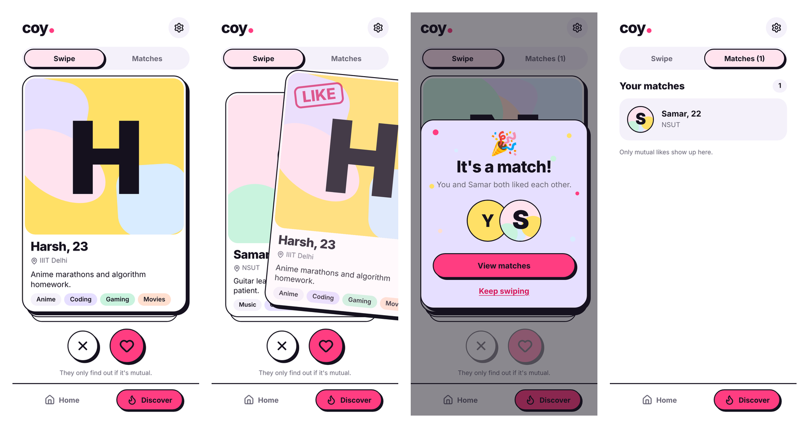
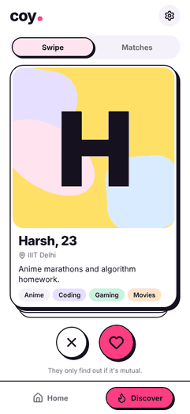

# Coy · Discover

A swipe-based **Discover** tab (Tinder/Bumble style) for a mock of **Coy**, an anonymous crush-matching app.
It is a standalone Next.js app: a header, a bottom tab bar (**Home**, intentionally blank, and **Discover**),
and under Discover a swipe deck, a Matches list and an "It's a match!" screen.

> **The core promise: never reveal who has liked you unless it is mutual.**
> Everything else in this project is secondary to that rule. See [How the core promise is protected](#how-the-core-promise-is-protected).





<sub>Screenshots were captured in an environment without access to Google Fonts, so they use the system
fallback font. With internet access the app loads Bricolage Grotesque.</sub>

## Run it

Requires **Node 20+**. Works on Windows, macOS and Linux (no shell-only scripts).

```bash
npm install
npm run dev      # then open the URL it prints (http://localhost:3000)
```

The first `dev`/`build` downloads the Bricolage Grotesque font from Google Fonts, so it needs internet access once.
`/` redirects to `/discover`.

| Command | What it does |
|---|---|
| `npm run dev` | Dev server |
| `npm run build` / `npm start` | Production build / server |
| `npm test` | Runs the vitest suite once (`npm run test:watch` to watch) |
| `npm run lint` | ESLint |
| `npm run photos` | Regenerates the placeholder portraits in `public/photos/` (deterministic) |

### Reset the demo

Any of these start the demo over (all swipes and matches are cleared, every profile comes back):

- Tap the **gear** in the header, then **Reset demo data**.
- Delete `data/state.json` (it is git-ignored and created on the first swipe).
- `curl -X POST http://localhost:3000/api/reset`

Reset is enabled whenever `NODE_ENV !== "production"`. Under `npm start` (production mode) it returns `403` unless you
set `ALLOW_RESET=true`:

```bash
ALLOW_RESET=true npm start                 # macOS / Linux
$env:ALLOW_RESET="true"; npm start         # Windows PowerShell
```

## Tests

`npm test` runs 87 tests (no browser needed):

| File | What it checks |
|---|---|
| `tests/swipe.test.ts` | Matching rules: like on someone who likes you matches; like on anyone else, or a pass, never does; repeats are idempotent; unknown ids are rejected; 72 concurrent swipes cannot lose a write or create a duplicate match |
| `tests/feed.test.ts` | The feed excludes swiped profiles, never repeats a profile across calls, and returns an empty deck (not an error) at the end |
| `tests/feed-order.test.ts` | The first 8 cards contain 2-4 profiles that already like you, and the order is not sorted by that secret |
| `tests/privacy.test.ts` | **Leak tests**: no response contains `likedMe` or any field outside the public `Profile`; a non-match looks identical to a pass; a static scan proves client code never references the secret, the seed file or server modules |
| `tests/api.test.ts` | Route validation (400/404), `force-dynamic`, reset (incl. the production 403), persistence across restarts, corrupt-state recovery, the `/feed` `/swipe` `/matches` rewrites |
| `tests/discover-reducer.test.ts` | The client queue: dedupe, optimistic swipes and rollback, match queue, toasts, reset |
| `tests/api-client.test.ts`, `tests/seed.test.ts`, `tests/setup.test.ts` | Typed fetch helpers and errors, seed data shape, test setup |

Gestures, layout and motion are not covered by unit tests. They were verified by hand in headless Chromium against the
production build (see [Verification](#verification)).

## API

All routes live under `/api/*`; `/feed`, `/swipe` and `/matches` are rewrites to the same handlers. Every response is
`Cache-Control: no-store`. A profile in any response has exactly these fields: `id, name, age, photo, bio, location, interests`.

| Route | Request | Success | Errors |
|---|---|---|---|
| `GET /api/feed?limit=10` | `limit`: default 10, clamped to 1-20 (non-numeric -> 10) | `200 { profiles: Profile[], remaining: number }`. Profiles the user has **not** swiped on, in a stable shuffled order. `remaining` is the total unswiped count. An empty deck is `{ "profiles": [], "remaining": 0 }`, not an error | |
| `POST /api/swipe` | `{ "profileId": "p07", "direction": "like" \| "pass" }` | `200 { matched: false }` or `200 { matched: true, match: Profile, matchedAt: ISO }`. Swiping a profile again changes nothing and returns the original outcome plus `"alreadySwiped": true` | `400 { error: "invalid_body" }`, `404 { error: "profile_not_found" }` |
| `GET /api/matches` | | `200 { matches: { profile: Profile, matchedAt: ISO }[] }`, newest first, mutual matches only | |
| `POST /api/reset` | | `200 { ok: true }`. Deletes `state.json` | `403 { error: "reset_disabled" }` in production unless `ALLOW_RESET=true` |

Any unexpected failure returns `500 { error: "internal_error" }` (logging only the error name).

## How the core promise is protected

Coy only works if nobody can tell who liked them before they like back. That rule shapes the whole stack:

1. **The secret never leaves the server.** Whether a profile already likes you (`likedMe`) exists only in `data/profiles.json`
   and `lib/server/` (`import "server-only"`). Responses are built by mapping each seed profile to the public `Profile` shape
   with an explicit allow-list of fields; the seed object is never spread or returned.
2. **A match is decided in exactly one place**: `POST /api/swipe`, when you like someone who already likes you. A pass never matches,
   and `GET /api/matches` re-checks every record against its swipe and the seed, so a hand-edited state file cannot invent one.
3. **A "no" looks like every other "no".** A like that is not returned answers `{ "matched": false }`, byte-for-byte the same as a
   pass. You learn nothing about someone you liked who did not like you back, and a passed-on admirer simply never appears again.
4. **The feed order cannot be used as a side channel.** The deck is a shuffle of the profile *ids* with a seeded PRNG
   (`mulberry32`, seed 21) that never sees the secret, so people who like you are not bunched at the front. The seed was chosen once, with a
   throwaway script, so a demo meets a match within the first few swipes (3 of the first 8 cards).
5. **The UI adds no hints**: no "likes you" badges or counts, no highlight, no different animation before a swipe.
6. **It is enforced by tests**, not just by convention (see `tests/privacy.test.ts`), and checked against the production build:
   `likedMe` appears only in server chunks, never in client assets, prerendered pages or any response.

The seeded `likedMe` values exist only as server-side mock data. In production they would be rows in a swipes table that is
never exposed to clients.

## Design decisions

- **A JSON file for persistence.** `data/state.json` (git-ignored, created on the first swipe) needs no database or native
  dependency and works on Windows. `lib/server/db.ts` re-reads it for every request, serializes writes with a promise-chain lock and
  writes atomically (temp file in the same folder, then rename, with a retry for Windows file locks). The lock lives on `globalThis` because dev
  servers can load a module once per route bundle.
- **Optimistic swipes.** The card leaves the queue the moment it is swiped and the request follows. If it fails, the card comes back
  on top with a toast. A per-card lock ignores input on a card that is already leaving.
- **A seeded shuffle** (above) keeps the feed stable across reloads and independent of the secret.
- **Gestures with framer-motion.** One `DeckCard` component serves every stack position (keyed by profile id), so promoting the next
  card is a spring rather than a remount. Buttons and arrow keys call the same fly-out as a drag, through one imperative handle.
- **A pure reducer for client state.** `hooks/useDiscover.ts` keeps its queue logic in an exported reducer (unit-tested), with the
  hook adding effects: prefetch at 3 cards left, dedupe against swiped and queued ids, rollback, a match queue, and a generation
  counter that ignores responses from before a reset.
- **Soft neo-brutalism with CSS variables.** Tokens and `.neo-*` recipes live in `app/globals.css`; hard offset shadows, 2px ink
  borders, pill buttons, no gradients or blur.
- **Accessibility.** Real buttons and arrow-key support for every gesture, a focus-trapped modal that restores focus, visible focus
  rings, `prefers-reduced-motion` (no tilt or fly-out, fade only), and safe-area insets.

## Choices where the spec was ambiguous

- `?limit=`: missing or non-numeric falls back to 10; out-of-range numbers are clamped to 1-20.
- Cache Components (enabled by the generator) is turned off, because `export const dynamic = "force-dynamic"` is not allowed with it.
  `@types/node` is `^22` because vitest 5 requires it.
- The tab bar is the bottom flex child of a `100dvh` column instead of `position: fixed`; the result is identical and the page never scrolls.
- The selected segment of the Swipe / Matches control is a soft-pink pill with an ink border and small hard shadow. The label shows
  `Matches (n)` only when `n > 0`.
- A match response with `alreadySwiped: true` still opens the match screen: that only happens when a retry follows a lost response,
  so the user never saw it. "View matches" clears all waiting matches; "Keep swiping" dismisses one.
- A 404 on swipe (profile gone) keeps the card removed, instead of rolling it back and trapping the user on it.
- The stacked cards behind the top one are flat (no hard shadow), otherwise their shadows merge into a heavy black band.
- The deck has a 300px minimum height: on very short screens (a 320x568 phone, landscape phones) the content area scrolls a little
  instead of squashing the card.
- Cards drag with the pointer offset deciding the commit (110px) while elasticity makes the card itself travel about 70% of that.

## Deploying (Vercel and other read-only hosts)

Local `npm run dev` / `npm start` is the primary demo path. On a read-only filesystem such as Vercel, `./data` cannot be written, so
`DATA_DIR` (default `./data`) falls back to the OS temp directory. **State there is ephemeral**: it can disappear between requests or deployments and is not
shared between instances. Set `ALLOW_RESET=true` if you want the reset button in a production deployment.

## Project layout

```
app/
  globals.css            design tokens and .neo-* recipes
  layout.tsx             font, metadata, viewport (viewport-fit=cover)
  page.tsx               redirects to /discover
  (app)/                 shared shell: header + tab bar
    home/page.tsx        blank on purpose
    discover/page.tsx
  api/{feed,swipe,matches,reset}/route.ts
components/              Header, TabBar, Logo, Modal, Toast, SettingsButton
components/discover/     DiscoverView, SwipeDeck, ProfileCard, ActionButtons, SegmentedControl,
                         MatchModal, MatchesList, EmptyDeck, FeedError, CardSkeleton, DeckFrame
hooks/                   useDiscover, useSwipeKeys
lib/                     types.ts (shared Profile), api-client.ts, demo-reset.ts
lib/server/              server-only: db, seed, feed, swipe, shuffle, http
data/profiles.json       36 seed profiles (server-only)
public/photos/           36 generated placeholder portraits
scripts/generate-photos.mjs
tests/                   vitest suite

```

## Verification

Besides the unit tests, the production build (and `next dev`) was driven in headless Chromium: drag, spring-back, commit and flick;
buttons and arrow keys; the per-card lock; touch events; prefetch and a full pass through all 36 profiles; failed-swipe rollback;
feed failures; the match flow; URL sync of the Swipe / Matches view; settings and reset; reduced motion; emulated safe-area insets;
no horizontal or page scroll and no clipped content at 360x640, 375x667, 390x844, 412x915, 480x800, 768x1024, 1280x800 and 1920x1080;
no hydration warnings in dev. Those browser checks are not part of the committed test suite.

## What I would build next

- Real authentication and sign-up, with the user's own likes stored in a database `swipes` table that is never exposed.
- Chat once two people match, plus push or in-app notifications.
- Report and block, with moderation of real photos and profile text.
- Pagination and rate limiting on the API, and committed end-to-end tests (Playwright) for the gestures.
- Profile editing and photo upload.
